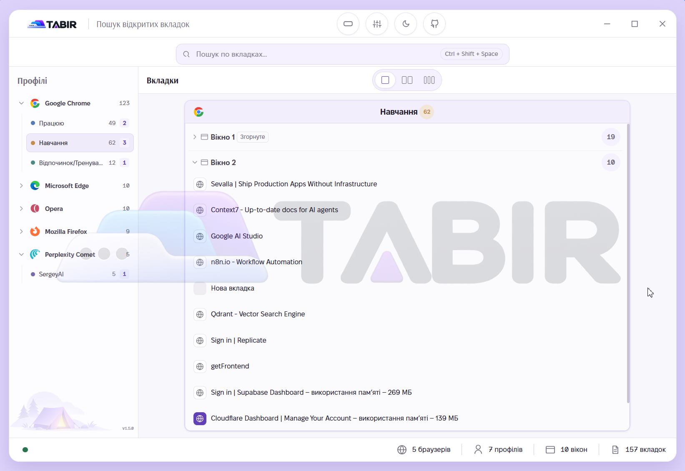
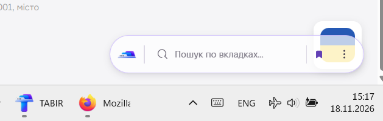
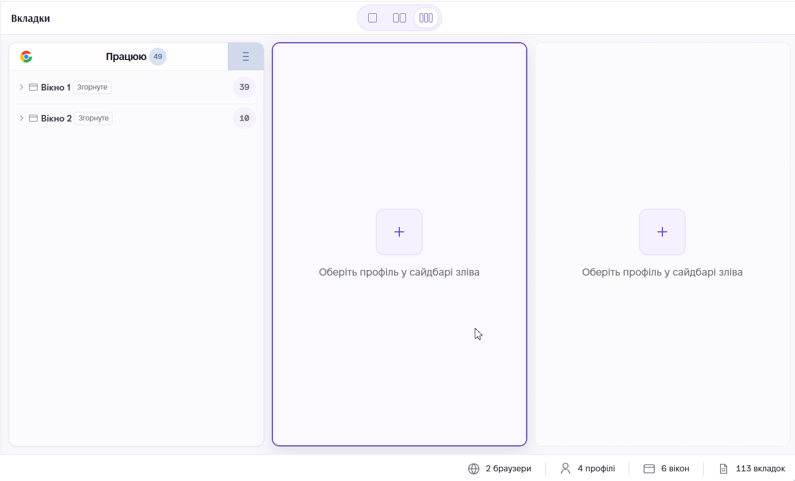
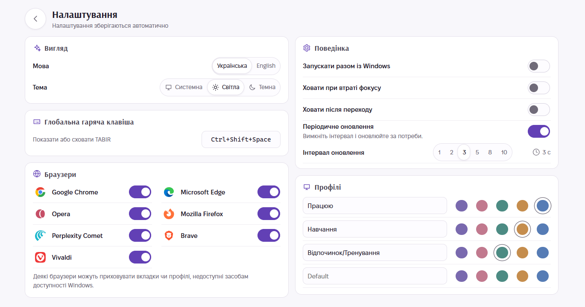

# TABIR

Find the tabs you need fast and switch between them with ease.

Швидко знаходьте потрібну вкладку та зручно перемикайтеся між вкладками браузерів у легкому застосунку для Windows.

## Screenshots / Знімки екрана

### Main window / Головне вікно

### Compact mode / Компактний режим

### Split-screen

### Settings / Налаштування

## Українська

TABIR — це застосунок для Windows, який допомагає швидко знаходити та відкривати вкладки у вікнах запущених браузерів. Пошук працює за назвами вкладок, а також за URL, якщо браузер надає адресу активної вкладки через Windows UI Automation. Отримання URL працює не для всіх браузерів і вкладок. Виберіть результат, щоб перейти до потрібної вкладки.

### Можливості

- Пошук відкритих вкладок за назвою; пошук за URL доступний, якщо адресу вдалося зчитати.
- Групування вкладок за браузерами та профілями.
- Перемикання на вибрану вкладку та її вікно браузера.
- Гаряча клавіша `Ctrl+Shift+Space` миттєво показує або ховає TABIR; комбінацію можна змінити в налаштуваннях.
- Режим розділеного екрана з однією, двома або трьома колонками для одночасного перегляду до трьох профілів.
- Компактний режим для швидкого доступу; вікно можна закріпити поверх інших.
- Налаштування мови, теми, автоматичного запуску та оновлення вкладок.
- Підтримка Google Chrome, Microsoft Edge, Opera, Mozilla Firefox, Perplexity Comet, Brave та Vivaldi.

### Гаряча клавіша

Натисніть `Ctrl+Shift+Space`, щоб показати або сховати TABIR, не шукаючи його вікно. Комбінацію можна змінити в налаштуваннях: виберіть поле гарячої клавіші та натисніть потрібне поєднання клавіш.

### Режим розділеного екрана

Виберіть одну, дві або три колонки, щоб одночасно переглядати вкладки до трьох профілів браузера. Профілі для колонок вибираються на бічній панелі.

### Технології

- **Tauri 2** — оболонка настільного застосунку.
- **React та TypeScript** — інтерфейс користувача.
- **Rust** — нативна логіка для Windows.

### Налаштування «Поведінка»

- **Запускати разом із Windows** — автоматично запускати TABIR після входу до Windows.
- **Ховати при втраті фокусу** — ховати вікно TABIR, коли ви переходите до іншого вікна. Повернути TABIR можна гарячою клавішею.
- **Ховати після переходу** — ховати TABIR після вибору вкладки та перемикання до неї у браузері.
- **Періодичне оновлення** — автоматично повторно сканувати відкриті вікна й вкладки браузерів, поки TABIR відкритий. Якщо вимкнути, вкладки можна оновлювати вручну.
- **Інтервал оновлення** — частота автоматичного сканування: 1, 2, 3, 5, 8 або 10 секунд. Цей параметр доступний, коли періодичне оновлення увімкнене.

### Запуск

1. Відкрийте розділ **Releases** цього репозиторію та завантажте останній файл `tabir_v*.exe`.
2. Запустіть завантажений файл. Встановлення не потрібне.
3. Потрібна Windows 10 або 11.

\* Примітка: TABIR використовує WebView2 Runtime для інтерфейсу. Зазвичай він уже є у Windows; встановлюйте його лише якщо TABIR повідомить, що компонента немає. Браузер Microsoft Edge не потрібен.

### Налаштування та приватність

Налаштування зберігаються у файлі `%APPDATA%\app.tabir.tabs\settings.json` і оновлюються автоматично. У Windows цей шлях зазвичай відповідає `%USERPROFILE%\AppData\Roaming\app.tabir.tabs\settings.json`.

TABIR знаходить вкладки через Windows UI Automation і не потребує розширення для браузера. Вміст вкладок і кеш URL зберігаються лише в пам’яті та не записуються на диск. Доступність вкладок і профілів залежить від того, які дані браузер показує через інтерфейс доступності Windows; приховані вкладки або робочі простори можуть не відображатися.

## English

TABIR is a Windows app that helps you quickly find and open tabs in running browser windows. Search always matches tab titles and can also match URLs when the browser exposes the active tab's address through Windows UI Automation. URL access is not available for every browser or tab. Select a result to switch to that tab.

### Features

- Search open tabs by title; URL matching is available when the address can be read.
- Group tabs by browser and profile.
- Switch to the selected tab and its browser window.
- Use `Ctrl+Shift+Space` to show or hide TABIR instantly; customize the shortcut in Settings.
- View up to three browser profiles side by side using one-, two-, or three-column split-screen layouts.
- Use compact mode for quick access, with an option to keep it above other windows.
- Configure language, theme, startup behavior, and tab refresh.
- Supports Google Chrome, Microsoft Edge, Opera, Mozilla Firefox, Perplexity Comet, Brave, and Vivaldi.

### Global shortcut

Press `Ctrl+Shift+Space` to show or hide TABIR without searching for its window. To change it, focus the shortcut field in Settings and press the desired key combination.

### Split-screen layout

Choose one, two, or three columns to view tabs from up to three browser profiles at once. Select the profiles for each column from the sidebar.

### Technology

- **Tauri 2** — desktop application framework.
- **React and TypeScript** — user interface.
- **Rust** — native Windows logic.

### Behavior settings

- **Launch at Windows startup** — start TABIR automatically when you sign in to Windows.
- **Hide when focus is lost** — hide the TABIR window when you switch to another window. Use the global shortcut to bring it back.
- **Hide after switching** — hide TABIR after selecting a tab and switching to it in the browser.
- **Scheduled refresh** — automatically rescan open browser windows and tabs while TABIR is open. Turn it off to refresh tabs manually when needed.
- **Refresh interval** — choose how often automatic scans run: every 1, 2, 3, 5, 8, or 10 seconds. This option is available when scheduled refresh is on.

### Run TABIR

1. Open this repository's **Releases** section and download the latest `tabir_v*.exe` file.
2. Run the downloaded file. No installation is required.
3. Windows 10 or 11 is required.

\* Note: TABIR uses the WebView2 Runtime for its interface. It is usually already available on Windows; install it only if TABIR reports that it is missing. The Microsoft Edge browser is not required.

### Settings and privacy

Settings are saved automatically to `%APPDATA%\app.tabir.tabs\settings.json`. On Windows, this usually resolves to `%USERPROFILE%\AppData\Roaming\app.tabir.tabs\settings.json`.

TABIR discovers tabs through Windows UI Automation and does not require a browser extension. Tab snapshots and the URL cache stay in memory and are not written to disk. Tab and profile visibility depends on what each browser exposes through the Windows accessibility interface; hidden tabs or workspaces may not appear.
